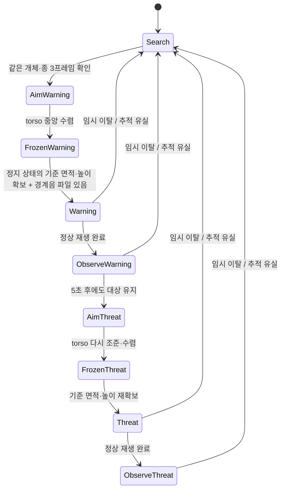

# ADAS Project

기존 보행자 안내 시스템의 **카메라·2축 짐벌·지향성 음향**을 야생동물 퇴치에
적용한 프로젝트다. 동물 검출, 조준, 음향 단계 전환의 기준 구현은
`animal/runtime.py`와 `animal/wildlife.py`이다.

이 통합 변경은 main `9eaa148`과 `feat/escape-and-height`의 `32882c1`을 기준으로 한다
(2026-10-18 KST). [통합 인수인계: 역할 구조도·상태 머신·변경 이력·남은 작업](docs/INTEGRATION_HANDOFF.md).
최근 실기 코드의 500 Hz, Kp 30/Kd 1.8, 유효 화각 28°/20°를 유지했다.
과거 1000 Hz 주석이나 다른 테스트 도구의 게인보다 실제 최신 코드를 기준으로 삼았다.

## 정식 운용

```bash
uv sync
uv run python main.py
```

장비와 음원을 준비한 환경에서는 **main.py 하나로 카메라 → 동물 분류/추적 →
모터 조준 → 경계음/위협음 → 정지·기본 자세 복귀까지 실행**한다. 모터 기본값은
ON이며 대상 탐색부터 시작한다. `start.sh`나 메뉴를 먼저 실행할 필요가 없다.

```bash
uv run python main.py --start-paused   # W/resume을 입력한 뒤 조준·재생 시작
uv run python main.py --dry-run        # 실제 영상, CAN·음향은 모의 실행
uv run python main.py --headless       # 미리보기 없이 터미널 명령으로 운용
uv run python main.py --no-motor       # 검출만 확인; 자동 음향도 시작하지 않음
```

옵션은 조합할 수 있다. 명시하지 않은 옵션은 `animal/settings.py`의 값을 따른다.
경계음 파일이 아직 없으면 조준·고정 후 경계음 대기 상태에 머문다.

Python 3.10, Ultralytics 8.4.72 등 의존성은 `pyproject.toml`/`uv.lock` 기준이다.
Linux WAV 재생에는 `aplay`(alsa-utils), macOS에는 `afplay`가 필요하다.

### 별도 실험 메뉴

`./start.sh`는 `uv run python tools/motor_manual_control.py`를 실행하는 편의
스크립트일 뿐이다. 삭제해도 정식 운용에는 영향이 없으며 직접 실험 도구를 실행해도 된다.

| 진입점 | 동작 |
| --- | --- |
| `main.py` | 정식 야생동물 퇴치 전체 파이프라인. 모터 기본 ON |
| `start.sh` 메뉴 1 | 동물 모델로 정식 코어를 시험하는 통합 실험. W/resume 대기부터 시작 |
| 메뉴 2 | 사람 pose 대역을 주입하는 통합 실험. 어깨·골반 4점으로 torso 생성, W/resume 대기 |
| 메뉴 3 | 이전 손들기·코 추적 데모 |
| 메뉴 4/5 | 공통 Tracker를 사용하는 수동 조그 / 음압 측정용 자세 유지 |
| `people/main_facetrack.py` | 기존 보행자 안내 앱 |

`main.py`와 `start.sh`/실험 메뉴는 서로 호출하지 않는다. 정식 `animal/`, `motor/`
코드도 `tools/`를 import하지 않는다. 실험 도구만 공통 코어를 **한 방향으로 재사용**한다.
메뉴 1/2는 조준·음향 단계까지 포함한 통합 시험이며 별도의 퇴치 로직 복사본이 아니다.
사람 대역 변환과 전용 설정은 `tools/person_proxy.py`에 있다.
두 경로 모두 반전 없는 동일 영상 좌표계·모터 어댑터를 사용한다.

| `animal/settings.py` | 기본값 / 의미 |
| --- | --- |
| `CAMERA_INDEX` | 4. Arducam B0538C, 요청 해상도 2592×1944, YUY2, 25 FPS |
| `ENABLE_MOTOR` | True. 정식 운용은 실제 모터 사용. `--no-motor`로 검출만 실행 |
| `START_PAUSED` | False. `--start-paused`로 시작 대기 선택. 메뉴 1/2는 항상 시작 대기 |
| `DRY_RUN` | False. True면 공통 런타임에서 CAN·실제 음향 없이 조준/재생 시간을 모의 실행 |
| `HEADLESS` | False. True면 터미널 명령 사용 |
| `WARNING_OBSERVATION_SECONDS` | 5.0. 경계음 정상 종료를 확인한 뒤 관찰할 시간 |
| `AUDIO_VARIANT` | 기존 위협음 original / eq / pitch / pitch_eq |
| `WARNING_AUDIO_VARIANT` | 별도 경계음 original / eq |

`ENABLE_MOTOR=False`, `DRY_RUN=False`이면 검출은 가능하지만 조준 수렴을
확인할 수 없으므로 자동 재생하지 않는다. DRY_RUN도 없는 경계음을 생성하거나
위협음으로 대체하지 않는다. 모의 조준은 영상 속 torso가 중앙에 들어와야 수렴한다.
DRY_RUN은 메뉴 1/2와 main.py의 공통 런타임 설정이며 기존 메뉴 3/4/5에는 적용하지 않는다.

## 시나리오와 역할



- **검출/연결 — `animal/inference.py`, `animal/perception.py`**: raw `predict()` 결과에서
  멧돼지·고라니를 각각 별도 ByteTrack으로 추적한다. `(종, 내부 ID)`를 세션 ID로
  변환하므로 종 사이의 ID 재사용을 막는다. torso는 ByteTrack에 넣지 않고
  포함관계와 거리 기반 일대일 매칭으로 연결한다. 신뢰도 0.2 torso도 유지한다.
- **시나리오 — `animal/wildlife.py`**: 대상 확정, 조준/관찰 구분, 이탈·유실 종료,
  경계음→위협음 전환을 한 곳에서 결정한다. 종료 이벤트를 먼저 처리하므로
  이탈 프레임에서 다시 조준하거나 새 음향을 시작하지 않는다.
- **조준 — `animal/aiming.py`**: torso 중심 3프레임 평균, 작은 중앙 오차의 deadband,
  고립된 큰 좌표 점프 거부를 담당한다. 큰 이동이 2프레임 연속 확인되면 새 위치를
  받아들인다. torso 미검출 시 전체 동물 중심으로 바꾸지 않고 마지막 목표를 유지한다.
- **모터 — `motor/dm4310_tracker.py`**: 실측 위치에 영상 오차로 계산한 각도 보정을
  더하고, 500 Hz 목표로 CAN MIT 명령을 전송한다. 조준 수렴 후 목표 각도를 고정해도
  PD 유지 제어는 계속된다. 재생·관찰 중 검출 위치를 따라 새 목표를 만들지 않는다.
- **음향 — `animal/audio.py`**: 종별 음원 선택, 프로세스 시작/완료/실패/중단 상태와
  오류 출력을 담당한다. 프로세스 시작을 성공적인 재생 완료로 간주하지 않는다.

조준 수렴은 raw/평균 torso 중심이 화면 각 축의 중앙 ±1.5% 안에 있고,
두 축 속도의 절댓값이 각각 **0.2 rad/s 이하**인 상태를 0.5초 유지한 경우다. 3개 샘플이 먼저
필요하고 미검출/이상치는 수렴 타이머를 끊는다. 모두 `animal/settings.py`에서 조정한다.
이 수렴 판정은 통합 시나리오에서 새로 추가했으며, 속도 문턱은 초기 0.05에서 0.2로 완화했다.
고정 직후 0.4초 동안 유효한 bbox 면적·높이 기준을 모으므로 실제 음향은 그 뒤에 시작한다.
화면 가장자리로 잘린 bbox만 계속 나오면 기준 확보 단계에서 기다린다.

위협음은 한 번 재생한 뒤 **같은 자세에서 관찰을 유지**한다. 추가 반복 재생이나
무제한 재조준 정책은 넣지 않았다. 이탈·유실·사용자 정지로 현재 시도가 종료된다.

### 임시 이탈 조건과 미검출

면적 감소·급속 이동을 임시 이탈 조건으로 사용하되, 새 브랜치의 **면적 AND 높이**와
**실제 시간 기준 속도** 개선을 반영했다. **모터를 고정한 단계에서만** 검사하고 조준 중 샘플은 버린다. 재조준 뒤에는 기준과 이동 이력을 다시 만든다.

| 조건 | 처리 |
| --- | --- |
| 면적 ≤ 기준의 50% AND 높이 ≤ 80%가 0.5초 유지 (0.35초 중앙값 평활) | 임시 이탈: 음향 중지, 현재 목표 유지, 재탐색 |
| 최근 5개 torso 중심의 이동 속도 ≥ 초당 평균 bbox 폭의 2.5배 | 같은 임시 이탈 처리 |
| 동물 bbox가 잠시 미검출 | 마지막 모터 목표 유지. 같은 ID가 돌아오면 계속 |
| bbox 미검출이 2초 지속 | 추적 유실 확정: 음향 중지·재탐색 |
| 카메라 영상 자체가 2초 이상 미수신 | 독립 watchdog이 음향 중지·목표 고정·재탐색 |
| 카메라는 정상이나 유효 추론 결과가 2초 이상 없음 | 별도의 perception timeout 처리 |
| 캡처 후 1초 이상 지난 추론 결과 | 조준에 쓰지 않고 버림 |

짧은 bbox 누락 동안에는 재생도 유지하다가 **2초 유실이 확정되면** 중지한다.
이탈 ID는 계속 보이는 동안 재선정하지 않으며 2초 동안 사라진 뒤 제외를 해제한다.
이탈 후 다른 대상 선택 전 유예는 1초다. 급속 이동은 **가속도가 아닌 속도**이며 실제
캡처 시각으로 정규화한다. 5개 샘플 수집 지연은 FPS에 따라 다르다. 실제 보호 구역
경계 판정이나 퇴치 성공 증거를 의미하지 않는다. 상세 기준과 검증 범위는
[인수인계 문서](docs/INTEGRATION_HANDOFF.md)를 참고한다.

### 정지·복귀와 진단

- 창: **R / E / Space = stop**, **W = resume**, **Q / ESC = 종료**.
- 터미널: **`stop` / `resume` / `quit` + Enter**. 추론이 진행 중이어도 별도 감시
  스레드가 터미널 입력을 받는다(통상 50 ms 간격, 하드 실시간 보장 없음).
- `stop`은 추적·음향을 중지하고 현재 위치를 잡은 뒤 `Tracker.go_default()`로
  **공통 기본 자세**에 2초 램프 복귀한다. 설정은 `motor/config.py`의
  `DEFAULT_YAW_DEG=0`, `DEFAULT_PITCH_DEG=30`이다. +30°는 기존 기본 자세이며
  엔코더 영점이나 정지 코드에 따로 고정한 값이 아니다. 자세 변경은 이 설정 한 곳에서 한다.
  다음 검출은 복귀를 취소할 수 없다.
  `resume` 전에는 정지 상태가 유지되고, 정지 전에 시작한 추론 결과도 폐기한다.
- Q/ESC 종료도 기본 자세로 복귀 후 연결을 닫는다. 통신 고장 때는 복귀를 강행하지 않는다.
- 이는 **소프트웨어 정지 후 복귀**이며 전원을 끊는 하드웨어 E-stop이 아니다.
- 초기 MIT 모드 확인과 양 축의 실제 위치 응답이 없으면 운전을 시작하지 않는다.
  응답이 0.5초 넘게 오래되거나, 고장 코드/통신 예외/제어 스레드 종료가 있으면 고장을
  상위 시나리오에 전달한다. 제어 스레드는 가능한 범위에서 양 축 disable을 보낸다.
- 음향 실패는 종료 코드·stderr를 기록하고 FAULT로 대기한다. 복구 후 `resume`으로
  경계음부터 다시 시도한다. 종료 코드 0은 재생기 정상 종료 확인이며 실제 음압 측정은 아니다.

`Tracker.health()`는 양 축의 피드백 경과 시간·원시 상태 코드를 반환한다.
DM-J4310 V1.0 설명서는 고장 0x8~0xE만 명시하므로, 정상 상태는 펌웨어 호환을
위해 0/1을 허용한다. 실기에서 0=disabled, 1=enabled를 확인한 경우
`motor/config.py`의 `HEALTHY_STATUS_CODES=(1,)`로 엄격하게 설정할 수 있다.
근거: [제조사 J4310 설명서의 피드백 정의](https://damiao.enactic.ai/en/assets/files/dm-j4310-2ec-v1.1-zh-5d089e0b013d8e2fc203c5b670008a66.pdf).

## 음원

현재 종 매핑: 모델 `0=boar` → `boar`, `1=deer` → `water_deer`, `2=torso` → 조준용.
모델 이름과 매핑이 다르면 모터를 열기 전에 중단한다.

| 단계 | 원본 | EQ | 상태 |
| --- | --- | --- | --- |
| 경계음 | `assets/warnings/<종>/*.wav` | `assets/warnings_eq/<종>/*.wav` | 아직 없음. 빈 폴더 구조만 준비 |
| 위협음 | `assets/audio/<종>/*.wav` | `assets/audio_eq/<종>/*.wav` | 기존 각 종 10개 사용 |

경계음은 선택한 버전의 각 종 폴더에 **1개 이상 유효한 WAV**를 넣고 재시작하면
사용된다. 없으면 `missing_warning_asset` 상태로 기다리며 위협음으로 건너뛰지 않는다.
경계음 raw/EQ는 별도로 선택한다. 기존 EQ/피치 생성 도구는 위협음 폴더를 대상으로
하므로 새 경계음은 해당 폴더에 별도로 준비한다.

카메라·모터 없이 음향만 시험:

```bash
uv run python tools/play_audio.py --stage threat --label boar
uv run python tools/play_audio.py --stage warning --label water_deer
uv run python tools/play_audio.py --stage threat --label boar --dry-run
```

### 음원 EQ (1.5~2kHz 강조)

EQ = 주파수별 볼륨 조절. 스피커 지향성이 잘 나타나는 1.5~2kHz는 그대로
두고 나머지 대역은 −12dB 줄여서 그 대역을 상대적으로 강조한
버전을 `assets/audio_eq/`에 만들어 둔다(`audio_test/with_reflector.csv`
기준 2000Hz는 45~90°에서 0° 대비 약 20~23dB 줄어 지향성이 뚜렷함).

```bash
uv run python tools/eq_filter.py                    # 20개 생성 + 클립별 비교표 출력
uv run python tools/eq_filter.py --compare boar_07  # 원본 → 1초 → EQ 연속 재생
```

- 선형 위상 FIR이라 대역별 볼륨만 바뀌고 소리의 시간 모양·길이는 원본과 같다.
  1.0→1.5kHz, 2→3kHz는 서서히 전환.
- 평균 크기(RMS)를 원본과 맞춰서, 원본과 비교할 때 소리 크기 차이로 판단이 흐려지지
  않게 했다(최대값은 −1dBFS 이하로 제한).
- 대역·감쇠량 등은 `tools/eq_filter.py` 맨 위 상수만 바꾸고 다시 실행하면 된다.
  원본에서 빠진 클립의 EQ 파일은 그때 같이 지워진다.
- EQ는 이미 있는 소리의 크기만 바꾸므로, 원본에 1.5~2kHz 성분이 거의 없는
  클립(예: `boar_07` 0.1% → 1.3%)은 강조 효과가 약하다 — 생성 시 출력되는
  "1.5~2kHz 비중" 열로 클립별 효과를 확인할 것.
- 실제 재생에 쓰려면 `animal/settings.py`의 `AUDIO_VARIANT = "eq"`.

### 음원 피치 시프트 (1.5~2kHz 쪽으로 음높이 올리기)

위 EQ는 원래 있는 1.5~2kHz 소리의 크기만 바꿀 수 있는데, 원본 음원은
에너지가 대부분 550~1000Hz에 몰려 있어서 효과가 약했다. 그래서 소리 전체의
음높이를 올려 그 에너지 자체를 1.5~2kHz로 옮긴 버전도 만든다.

```bash
uv run python tools/pitch_shift.py                    # 생성 + 클립별 올린 양·비중 표
uv run python tools/pitch_shift.py --compare boar_07  # 원본 → pitch → pitch+EQ 연속 재생
```

| 버전 (`AUDIO_VARIANT`) | 폴더 | 1.5~2kHz 비중 (서로 다른 16개 클립 중앙값 / 최저) |
| --- | --- | --- |
| `"original"` | `assets/audio/` | 1.7% / 0.1% |
| `"eq"` | `assets/audio_eq/` | 15.6% / 1.3% |
| `"pitch"` | `assets/audio_pitch/` | 27.4% / 16.2% |
| `"pitch_eq"` | `assets/audio_pitch_eq/` | 65.2% / 40.5% |

- 클립마다 0~12반음(`MAX_SEMITONES`, 1옥타브)을 0.5반음 간격으로 실제로
  올려 보고 1.5~2kHz 비중이 가장 큰 값을 고른다(이번 결과 +3~+12반음).
  클립마다 에너지가 몰린 위치가 달라서 전부 같은 만큼 올리면 오히려 대역을
  벗어나는 클립이 생긴다.
- 길이·리듬은 그대로 두고 음높이만 올린다(phase vocoder). 많이 올릴수록 작은
  개·장난감 소리처럼 변하고, 짖는 소리의 시작이 약간 뭉개질 수 있다 —
  퇴치음으로서 위협감이 남는지는 직접 들어보고 판단할 것.
- 크기 맞추기·최대값 제한·원본에서 빠진 파일 정리는 EQ와 동일하고,
  `pitch_eq`의 EQ는 `tools/eq_filter.py` 설정을 그대로 쓴다.

> 실제 동물 회피 효과, 카메라·모터·스피커 통합 야외 동작은 아직 검증 전이다.

## 공용 좌표·기구 설정

`motor/config.py`가 운용·수동 조그의 단일 설정 위치다.

| 항목 | 값 |
| --- | --- |
| 논리 각도 | 오른쪽 Yaw + / 위쪽 Pitch + |
| raw 모터 각도 | Yaw/Pitch 모두 논리 각도의 −1배 |
| CAN 위치·속도·토크 피드백 | 논리 좌표로 변환해 표시 |
| 제어 주파수 목표 | 500 Hz; 실제 달성 주파수는 별도 표시 |
| Kp / Kd | 양 축 30 / 1.8 |
| 유효 수평 / 수직 화각 | 28° / 20° |
| Yaw / Pitch 범위 | ±1.2 / ±0.6 rad (수동 메뉴에도 적용) |
| 기본 복귀 자세 | 0° / +30° |
| raw feed-forward torque | Yaw 0 / Pitch +2.3 N·m (기존 물리 보정 유지) |
| USB-CAN | `/dev/ttyACM0`, 921600 baud |
| CAN ID / Master ID | Yaw 0x01 / 0x11, Pitch 0x02 / 0x12 |

`Tracker.update(x,y)`는 최신 **실측 위치 + 영상 오차**로 목표를 만든다.
검출이 정중앙인 경우도 이전 목표를 유지하지 않고 최신 실측 위치로 갱신한다.
3프레임 평균/deadband는 야생동물 조준 어댑터에, 마지막 좌표 보유와 CAN 제어는
모터 어댑터에 있어 판단을 중복하지 않는다.

`tools/actuator_test.sh`와 `tools/actuator_conn_test.py`의 기본 Kp/Kd도 공유값을
읽는다. 이 두 저수준 도구 및 `zero_actuator.py`는 **raw 모터 좌표·단일 모터
벤치 시험**이다. 설치된 짐벌의 논리 각도/가동범위 적용은 Tracker 경로를 사용한다.
단독 도구의 임의각/60° 왕복은 짐벌 운용 명령과 다르다.

카메라 변환은 `animal/camera.py` 한 곳에서 처리한다. 특히 2차원 packed YUY2
`H×(2W)`를 2채널 `H×W×2`로 복원해 변환한다. 이를 회색 영상으로 읽던 이전 메뉴
경로는 가로 크기와 색/좌표 해석을 잘못 만들 수 있어 공통 함수로 교체했다.

## 얼굴 추적 — `people/main_facetrack.py`

```text
Arducam(25fps) → YOLOv8 pose → 손든지 ARM_UP_THRESHOLD(3초) 최대박스 확정
              → 코 좌표(얼굴박스로 노이즈 필터) → Tracker.update(x, y)
              → Yaw 각도+박스 크기로 구간이탈 판정 → 방향별 안내 음성
```

```bash
uv run people/main_facetrack.py           # 카메라 + YOLO 추적만
uv run people/main_facetrack.py --motor   # + Damiao 모터 제어
```

| 키 | 동작 |
| --- | --- |
| `w` | 재추적 (현재 트래킹 해제, 손든 사람 대기로 복귀) |
| `e` | `w` + 모터 중앙 복귀 |
| `s` | 샘플 음성 재생 |
| `+` / `-` | 볼륨 ±10% |
| `0` | 볼륨 기본값 복귀 |
| `o` / `p` | 안내 음성(greenlight/finish) 재생 |
| `q` | 종료 |

- `detection/base.py`의 `PoseDetector` 인터페이스(`detect(frame) -> List[PersonPose]`)만
  지키면 어떤 모델로도 교체 가능 — 기본 구현은 `detection/yolo_pose.py`의
  `YoloPoseDetector`(YOLOv8 pose, `assets/models/yolov8n-pose.pt`, GPU 자동 사용).
  파인튜닝 모델로 바꾸려면 `people/main_facetrack.py`의 `MODEL_PATH`만 수정.
- `animal/mp3_player.py`/`assets/voice/*.mp3`가 안내 음성을 담당.
- `legacy/`: `face_tracker_xl430_06_14.py`(이전 세대 Dynamixel 트래커),
  `local.py`(라즈베리파이 영상 스트림 서버, 별개 용도) — 둘 다 참고용.

## 검증과 남은 작업

하드웨어 없는 회귀 검증:

```bash
uv run python -m unittest discover -s tests -v
bash -n start.sh tools/actuator_test.sh
```

테스트는 경계음→5초 관찰→재조준→위협음, 고정 중 모터 목표 불변, 이탈/유실
종료 우선순위, stop latch, 오래된 추론 폐기, 실제 ByteTrack의 종/torso ID 분리,
재생 프로세스 실패, packed YUY2, 모터 부호·중앙 목표 갱신·CAN 장애를 다룬다.
새 브랜치의 회전/후퇴·시간 정규화와 운영 시나리오 연결, main 단독 실행·대기·dry-run,
수렴 속도 경계·설정 기반 복귀를 포함해 총 **61개 테스트**를
통과했다. 실제 카메라·모터 구동 및 실제 스피커 출력은 이 코드 변경에서 시험하지 않았다.
원본 브랜치의 540개 3D 시뮬레이션 성능 수치는 재현 자료가 없어 검증 결과에 포함하지 않았다.

다음 실기 작업은 다음 순서다.

1. **경계음 raw/EQ 업로드**: 두 종 각각 파일을 채우고 모델의 종 매핑과 청감 확인.
2. **기구 확인**: 양 축 + 명령의 실제 오른쪽/위쪽 이동, 영점, 범위, 0°/+30° 복귀,
   피드백 상태 코드와 실측 CAN 주파수 확인. 정지된 목표를 실제 기구가 유지하는지 확인.
3. **조준 기준 튜닝**: 현재 중앙 1.5%, 속도 0.2 rad/s, 유지 0.5초, 3프레임 필터와
   이상치 거리 15%를 실제 검출 FPS·진동·가림 조건에서 조정.
4. **종합 리허설**: 사람 대역으로 경계음 완료 후 5초, 재조준, 위협음 1회, 대상 소실,
   카메라 단절, 오디오 장치 오류, stop/resume을 확인. 이어 실제 동물 영상/현장 검증.
5. **최종 이탈 기준 및 반복 정책**: 현재 휴리스틱과 1회 위협음 후 관찰 정책을 현장에서
   평가. 보호 구역 좌표, 퇴치 성공 판단, 위협음 추가 반복 여부는 이후 요구사항으로 확정.

`animal/animal_escape_tracking_combined.py`는 기존 오프라인 분석 원본이며 운영 루프가
호출하지 않는다. `legacy/`는 이전 Dynamixel/영상 서버 자료다.
음향 측정 CSV는 [`audio_test/README.md`](audio_test/README.md)에 설명되어 있다.
