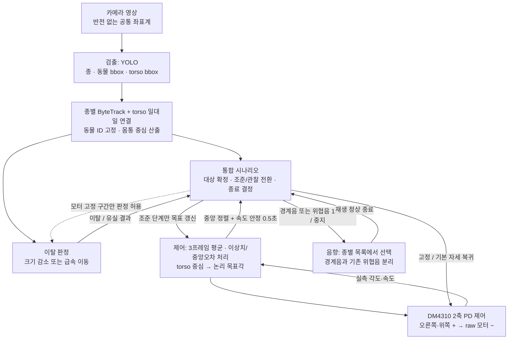
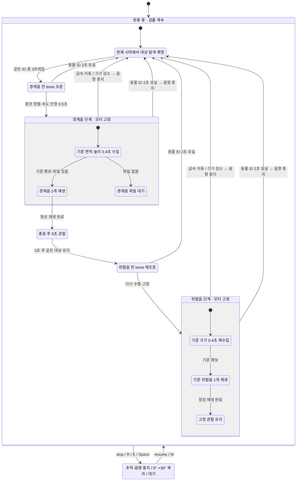

# 야생동물 음향 퇴치 통합 인수인계

작성 기준: **2026-10-18 (KST)**. main의 `9eaa148`에 통합 시나리오를 구현하고,
`feat/escape-and-height`의 `32882c1`을 병합한 상태를 설명한다.
동물·사람 대역 운영 코드는 `animal/`이다. 이전 보행자 안내 앱과 오프라인 분석
원본은 별도 앱/참고 자료이며 아래 상태 머신을 실행하지 않는다.

## 1. 팀별 역할과 데이터 흐름



**단계 전환의 소유자는 `WildlifeDeterrent` 한 곳이다.** 검출기는 motor/audio를 직접
호출하지 않고, 모터는 도주 여부를 판단하지 않으며, 재생기는 자체적으로 다음 음향
단계로 넘어가지 않는다. 따라서 같은 이탈 사건을 세 모듈이 서로 다르게 처리하지 않는다.
검출은 음향 재생·관찰 중에도 계속한다. 모터는 고정된 목표에 PD 제어만 계속한다.

| 역할 | 기준 파일 | 출력/책임 |
| --- | --- | --- |
| 영상 | `animal/camera.py` | 최신 프레임·캡처 시각, YUY2 공통 변환 |
| 인식/개체 연결 | `animal/inference.py`, `animal/person_proxy.py` | 종별 ID와 raw torso/pose torso |
| 대상·이탈 판정 | `animal/perception.py` | 선택한 동물, 연결 torso, 종료 사유 |
| 전환 결정 | `animal/wildlife.py` | 조준/고정/재생/재탐색/사용자 정지 |
| 조준 필터 | `animal/aiming.py` | 평균 좌표와 수렴 여부 |
| 모터 | `motor/dm4310_tracker.py`, `motor/config.py` | 논리 좌표 변환, PD 목표 유지, 실측 피드백 |
| 음향 | `animal/audio.py`, `animal/settings.py` | 단계별 음원 선택, 재생·중지·완료 |
| 공통 진입점 | `animal/runtime.py` | main.py와 메뉴 1/2가 같은 운영 루프 사용 |

## 2. 실제 상태 머신

아래 그림은 주행/퇴치 흐름만 다룬다. 통신·장치 장애 등 디버깅 상태는 제외했다.
`main.py`는 탐색부터 시작하고, 메뉴 1/2는 사용자 W/resume 대기부터 시작한다.



- **조준 중** 동물이 빠르게 움직이면 torso를 계속 조준한다. 카메라 이동 자체가
  영상 이동을 만들기 때문에 이 구간에서는 도주 판정을 끈다. 중앙에 수렴하지 않으면
  음향을 시작하지 않는다. 이때 모터 가동범위 밖의 대상도 자동 재생하지 못한다.
- **고정 중**에는 동물 위치가 바뀌어도 모터 목표를 갱신하지 않는다. 도주가 확인되면
  현재 자세를 유지하며 음향을 중지하고 현재 시야에서 다른 대상을 고른다.
  재탐색은 자동 좌우 스캔 동작을 의미하지 않는다.
- **일시적 미검출**은 마지막 목표를 유지하고, 재생 중이었다면 재생도 유지한다.
  동물 ID 유실이 2초 지속될 때 종료한다. torso만 없으면 전체 bbox 중심으로 대체하지
  않고 목표를 유지하며 새 수렴을 인정하지 않는다.
- **위협음 이후 무반응**은 고정 관찰을 유지한다. 무한 반복 재생·추가 재조준은 없다.
- **경계음 없음**은 파일 대기 상태다. 실행 중 자동 재로딩은 없으므로 업로드 후
  재시작한다. 파일이 없는 것을 성공 재생으로 처리하거나 위협음으로 건너뛰지 않는다.

## 3. 돌발상황 판정과 우선순위

| 상황 | 검출이 내는 결과 | 통합 시나리오 | 모터 | 음향 |
| --- | --- | --- | --- | --- |
| 조준 중 급속 이동 | 대상 좌표 계속 제공; 도주 계산 비활성 | 조준 지속 또는 2초 유실 후 탐색 | 새 torso 목표 추종 | 재생 전 |
| 고정 중 급속 이동 | `rapid_movement_detected` | 현재 대상 종료·1초 유예 후 재탐색 | 이탈 대상 추종 안 함 | 즉시 중지 요청 |
| 고정 중 면적·높이 동반 감소 | `bbox_area_reduced` | 같은 종료 처리 | 현재 자세 유지 | 중지 요청 |
| 폭/면적만 감소, 높이 유지 | 크기 감소 이탈 조건 불충족 | 현재 단계 유지 | 고정 단계면 계속 고정 | 현재 단계 유지 |
| 동물 bbox 잠깐 누락 | 일시 유실 | 같은 ID 복귀 대기 | 마지막 목표 유지 | 재생 중이면 유지 |
| 동물 ID가 2초 연속 미검출 | `tracking_lost` | 종료·재탐색 | 현재 자세 유지 | 중지 |
| torso만 미검출 | torso 없음 | 조준/수렴 보류; 동물 bbox 기반 크기 관찰은 가능 | 마지막 목표 유지 | 이미 고정·재생 중이면 유지 |
| 정상 경계음 종료 후 5초 동안 대상 유지 | 현재 대상 존재 | 위협음 전 재조준으로 전환 | 조준 재개, 재수렴 후 고정 | 재수렴 전에는 위협음 재생 안 함 |
| 사용자 stop | 사용자 명령 | 재개 전까지 정지 상태 고정 | 현재 위치 잡고 기본 자세로 복귀 | 중지 |

종료는 같은 프레임의 조준·재생보다 우선한다. 이탈한 ID는 계속 화면에 보이는 동안
재선정하지 않으며, 2초 동안 사라진 뒤 제외 목록에서 해제한다. 짧은 누락 후 같은 ID가
복귀하면 기존 단계가 유지된다. 사용자가 stop하면 이전 추론 결과도 폐기한다.

## 4. feat/escape-and-height에서 받아들인 것

원본 변경: [32882c1](https://github.com/u972637/ADAS_Project_v3/commit/32882c12952b45927c15abd3a25ee0276e1f0954).

| 항목 | 이전 main | 통합 기본값 |
| --- | --- | --- |
| 거리 증가의 대리 조건 | 면적 비율 ≤ 0.50 | **면적 ≤ 0.50 AND 높이 ≤ 0.80** |
| 기준 수집 | 1.0초 | 0.4초, 모터 고정 후 새로 수집 |
| 크기 중앙값 창 | 0.5초 | 0.35초 |
| 감소 조건 유지 | 1.0초 | 0.5초 |
| 빠른 이동 문턱 | 처리 프레임당 bbox 폭의 0.15배 | 25 FPS 환산 프레임당 0.10배 = **초당 bbox 폭의 2.5배** |
| 이동 시간 | 프레임 수 | 실제 캡처 시각의 차이 |
| 도주 판단 구간 | 조준 중도 포함 | 모터 목표가 고정된 구간만 |

이때 높이는 **영상 bbox의 픽셀 높이**이며 실제 동물의 높이·거리(m)를 복원하지 않는다.
`rapid_movement`는 가속도 계산이 아니다. 최근 연속 5개 torso 중심의 양 끝 변위를
실제 경과 시간과 평균 동물 bbox 폭으로 나눈 이동 속도다. 명목 FPS 25는 기존 임계값의
단위를 유지하는 상수이며 실제 처리 FPS를 측정한 값이 아니다.

시간 정규화로 5~25 FPS의 동일한 일정 속도 사례에 같은 문턱을 적용한다. 다만 5개
샘플이 모이는 시간은 FPS에 따라 다르고, 급가속 직후의 감지 지연까지 같아지지는 않는다.
몸 돌림에 따른 **크기 조건의** 오검출을 줄이는 개선이며, 모든 회전·자세 변화에서
급속 이동 조건까지 오검출이 없다고 보장하지 않는다. 눕기·가림·bbox 변화도 평가가 필요하다.
실제 보호 구역 경계와 퇴치 성공률은 아직 구현/검증된 개념이 아니다.

원본 README는 무작위 540개 3D 시뮬레이션과 성능 개선 비율을 주장하지만,
해당 커밋에는 시뮬레이터·입력·seed·결과 표가 없다. 이를 실측 성능으로 인용하지 않는다.
원본에 들어 있는 합성 단위 테스트 7개는 직접 통과를 확인했다. 통합 과정에서
면적/높이 문턱 도달 순서를 뒤집어 설명하던 테스트 주석·계산 기준도 바로잡았다.

## 5. 팀별 시도, 확인된 한계, 최종 통합 결정

개인의 작업 과정을 추측하지 않고 커밋과 실행 코드에서 확인되는 경로를 기록한다.

| 영역 | 기존에 구현한 것 / 근거 | 통합 시 확인한 문제 | 현재 결정 |
| --- | --- | --- | --- |
| 제어 | DM4310 MIT 제어, 실제 위치 기반 보정, 축별 Kp/Kd·중력보상 (`a92d8c5`, `e1b3b27`) | main만 좌우 반전; 수동/운영 범위·주파수 불일치; 중앙 검출에서 옛 목표 유지 | 논리 오른쪽·위쪽 +, raw −를 어댑터에서 변환. 설정 공유, 중앙 목표도 갱신 |
| 제어 초기 연결 | 수동 메뉴 초기 피드백 재시도 (`d58f958`) | 운영 Tracker에는 같은 보호가 없어 기본 위치 0으로 시작 가능 | 실제 피드백 확보 후 시작; 운전 중 상태 전달. 자세 복귀는 재개 전 검출이 취소하지 못함 |
| 검출 | ID 잠금, torso 연결, 면적/급속 이동 종료, 사람 pose 대역 (`e1b3b27`, `1886111`) | ByteTrack에 동물과 torso가 함께 들어가 ID 이동 가능; 조준 중 영상 이동도 도주로 판단 | 종별 동물 추적 + raw torso 연결. 도주는 고정 중에만 계산 |
| 새 도주 판정 | 면적 AND 높이, 시간 정규화 속도 (`32882c1`) | 원래 시나리오에 그대로 붙이면 이탈 프레임 조준/재생과 조준 중 오검출 문제가 남음 | 알고리즘을 `perception.py`에 이식하고 종료 우선 상태 머신에 연결 |
| 음향 | 각 종 10개 WAV, 무작위 비반복 선택, EQ와 pitch 변형 (`49d5e6d`, `9eaa148`) | 탐지 이벤트 기반 독립 재생 정책으로 제어 수렴·고정·유실과 연결되지 않음 | 경계음/위협음 단계별 요청을 통합 시나리오가 결정, 재생기는 실행·상태만 담당 |
| 시스템 통합 | main와 메뉴에서 유사 루프를 따로 구현 | 영상 형식·좌우·키 동작·재생 시점의 차이 | `animal/runtime.py` 하나를 main와 메뉴 1/2에서 호출 |

500 Hz, Kp 30/Kd 1.8, 유효 화각 28°/20° 및 raw Pitch feed-forward +2.3 N·m는
최신 main의 튜닝값을 유지했다. 이번 변경으로 물리 게인을 재튜닝한 것은 아니다.
새 상태 머신은 예전 독립 `TriggerPolicy`(3프레임 후 재생·10초 쿨다운)를 대체한다.

## 6. 검증 결과와 인수인계 체크

검증 환경: Python 3.10.20, Ultralytics 8.4.72, NumPy 1.26.4, lap 0.5.12.
이번 실행의 OpenCV는 4.11.0이며 프로젝트 잠금 버전은 4.10.0.84이다.
카메라/CAN/스피커를 실제로 열지 않았고, YOLO 가중치의 현장 정확도를 새로 평가하지 않았다.

```bash
uv sync
uv run python -m unittest discover -s tests -v
uv run python -m unittest tests.test_escape_tracker -v
bash -n start.sh tools/actuator_test.sh
```

- 합성·장치 대역 회귀 테스트 총 **56개**: 기존 통합 48개 + 새 도주 관련 8개.
- 실제 설치된 ByteTrack으로 종/torso ID 분리와 낮은 신뢰도 torso 보존 검증.
- 재생 프로세스 실패·중단, 모터 초기 피드백 없음·CAN 예외, 입력 타임아웃,
  정지 고정, YUY2 변환 등 검증. 이 진단 상태들은 위 시각화에서 생략했다.
- 새 도주 테스트는 회전/후퇴, 5/10/12.5/25 FPS의 이동 문턱, 실제 서비스 설정을 통한
  경계음 재생 중 회전 유지·후퇴 종료까지 포함한다.

| 다음 담당 | 남은 작업 | 완료 판단 |
| --- | --- | --- |
| 음향 | `assets/warnings/{boar,water_deer}` 및 `assets/warnings_eq/...`에 경계음 준비 | 정상 재생·정상 종료 뒤 5초 관찰, 이후 위협음으로 전환 |
| 제어 | 부호·영점·가동범위·기본 자세·고정 위치 유지 확인 | +명령이 오른쪽/위쪽, stop 후 0°/+30°, 재개 전 추종 없음 |
| 검출 | 실제 영상에서 몸 돌림·가림·눕기·달리기 재현, sim 원본/결과 보관 | 속도·크기 임계값의 오검출/미검출·감지 지연 기록 |
| 통합 | 사람 대역 후 현장 리허설, 보호 구역 정의와 위협음 반복 정책 확정 | 단계별 모터·음향 동작 및 이탈/유실 종료가 현장에서 일치 |

설정 위치와 실행 키는 [README](../README.md)를 따른다. 경계음 미업로드 상태에서는
자동 퇴치 시나리오가 해당 단계에서 대기하는 것이 정상이다.
