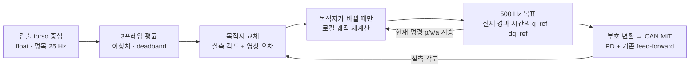

# 연속 궤적 제어 인수인계

2026-10-18. 전체 통합 변경의 기준은 [팀원 main 이후 변경표](CHANGES_FROM_TEAM_MAIN.md),
운용 단계는 [상태 머신](INTEGRATION_HANDOFF.md)을 참고한다.

## 1. 결정과 데이터 흐름

검출이 약 25 Hz로 좌표를 내면 **새 목적지만 갱신**한다. 다음 40 ms 안에 그 위치에
도착하도록 강제하지 않는다. 500 Hz 목표의 제어 스레드는 진행 중인 명령의 위치·속도·가속도에서
새 목적지까지 연결하고 속도·가속도·jerk를 제한한다. CAN에는 위치와 속도 참조를 함께 보낸다.



- `animal/aiming.py`: 시각 좌표 필터와 수렴 확인.
- `Tracker.update()`: 목적지를 실측 위치 + 영상 오차로 계산. 최신 명령 하나만 보관한다.
- `motor/trajectory.py`: Ruckig 0.19.4의 로컬 C++ state-to-state 계산과 궤적 읽기.
- `Tracker._control_thread()`: 단조 시각으로 참조를 읽고 `q_ref`, `dq_ref`를 송신한다.
  양 축 모두 논리값의 부호를 반전한다. raw Pitch feed-forward +2.3 N·m는 그대로다.
- 첫 시작만 실측 위치·속도와 가속도 0으로 초기화한다. 이후 재계산은 기존 **명령** p/v/a를
  이어받는다. 매 검출마다 속도를 0으로 리셋하거나 실측 위치로 명령을 순간 이동시키지 않는다.

5차 다항식도 경계조건을 잘 연결하면 연속성을 만들 수 있지만, 임의의 새 목적지와
현재 p/v/a에 대해 속도·가속도·jerk 상한까지 만족시키려면 시간 선택과 최대값 검사가 필요하다.
여기서는 이를 직접 중복 구현하지 않고 Ruckig의 상태 간 궤적 생성을 사용했다.
`intermediate_positions`는 사용하지 않으며 운용 중 클라우드 호출은 없다.
[Ruckig 공식 구현과 API 설명](https://github.com/pantor/ruckig).

## 2. 상한과 시간의 의미

`motor/config.py`에서 조정한다. 기구 검증 전의 초기 설정이며 명령 참조의 제한이다.

| 설정 | Yaw | Pitch | 단위 |
| --- | --- | --- | --- |
| `MOTION_MAX_VELOCITY` | 1.5 | 1.2 | rad/s |
| `MOTION_MAX_ACCELERATION` | 8 | 6 | rad/s² |
| `MOTION_MAX_JERK` | 100 | 80 | rad/s³ |
| `RANGE_RAD` | ±1.2 | ±0.6 | rad |

각도 목적지만 clamp하는 것으로 제동 중의 범위 초과를 막을 수 없으므로, 생성한 궤적의
전체 위치 최솟값/최댓값도 확인한다. 범위를 넘는 계획은 송신하지 않고 고장 처리한다.
실제 기구의 관성에 따른 오버슈트까지 이 검사만으로 막는다고 가정하면 안 된다.

`AIM_MAX_VELOCITY_RAD_S=0.2`는 **중앙에 조준이 안정됐는지 판단하는 실측 속도 문턱**이다.
위 표의 이동 속도 상한과 별개다. Kp/Kd 30/1.8은 이번에 재튜닝하지 않았다.

`go_to(duration)`의 duration은 **최소 시간**이다. 0이면 상한 내 최단 궤적을 사용하고,
양수여도 동역학 상한상 필요하면 더 길어진다. default 복귀는 최소 2초다.
`wait_until_complete()`는 최종 참조가 양 축 CAN 호출까지 전달됐는지 기다리며,
실제 기구가 최종 위치 오차 0에 도달했다는 확인은 아니다. 정상 종료는 최대 5초 대기한다.

이 설정에서 Yaw만 정지 상태에서 출발해 정지하는 계획의 예:

| Yaw 이동 | 참조 궤적 시간 |
| --- | --- |
| 1° | 0.1774초 |
| 5° | 0.3034초 |
| 15° | 0.4505초 |

이 시간은 **계산에 걸리는 시간**이 아니다. 이동 중에도 새 검출은 즉시 다음 재계산 대상으로
교체된다. 모든 5° 이동을 40 ms 안에 끝내는 조건과 작은 가속도/jerk 제한은 동시에
만족시킬 수 없다. 이전 3프레임 평균도 일정한 25 Hz 입력에서는 약 1프레임(40 ms)의
위상 지연을 만든다. 필요하면 `AIM_AVERAGE_FRAMES`를 2 또는 1로 낮춰 비교하되,
좌표 흔들림과 수렴 유지율을 같이 측정한다. 궤적 계산 최적화만으로 전체 추종 지연이 없어지지는 않는다.

## 3. 감속·고정·음향의 연결

`hold()`는 현재 명령 상태에서 목표 속도·가속도 0까지 제한 내에서 감속하는 요청이다.
움직이던 위치에 순간 고정하지 않으므로 제동 거리가 있다. 완료 후 그 위치를 유지한다.

경계음/위협음 앞의 기준 수집은 다음 순서다.

1. 기존 중앙 ±1.5%, 양 축 실측 속도 ≤0.2 rad/s, 0.5초 유지 조건으로 조준 수렴.
2. `hold()` 요청. 감속 완료를 양 축 송신 후 확인하고 실측 속도도 다시 확인.
3. 확인 시각 이후 **촬영한** 프레임으로 기준 bbox 크기를 0.4초 수집.
4. 기준이 확보되면 해당 단계의 음원 1개 재생.

추론이 늦게 끝나 감속 전 프레임이 뒤늦게 도착해도 기준에 섞지 않는다.
기준 수집 전 감속 중에는 크기/급속 이동 관찰 이력을 쌓지 않지만 대상 ID 유실은 계속 판단한다.
사용자 stop은 음향과 추적을 끊고 현재 명령 상태에서 default 복귀 궤적으로 연결한다.
이탈·유실은 default로 복귀시키지 않고 감속 후 현재 시야에서 재탐색한다.

## 4. 계산 성능과 실제 지연 관측

재현 명령은 장치를 열지 않는다.

```bash
uv sync
uv run python tools/benchmark_motion.py --ticks 60000 --output /tmp/motion-benchmark.json
```

2026-10-18 로컬 Linux x86_64, Python 3.10.20, Ruckig 0.19.4 결과:
[motion_local.json](benchmarks/motion_local.json).
1,000틱 준비 후 60,000틱의 논리 시각을 진행시키며 매 20틱에 목적지를 바꾼다.
실제 120초간 500 Hz 스케줄링을 시험한 결과가 아닌, 호출별 CPU 경과 시간 측정이다.

| 구분 | 횟수 | 중앙값 | p99 | 관측 최대 |
| --- | --- | --- | --- | --- |
| 기존 궤적 읽기 | 57,000 | 1.470 µs | 2.720 µs | 21.502 µs |
| 재계산 포함 | 3,000 | 5.690 µs | 13.462 µs | 20.013 µs |

Python wrapper·현재 상태 검증·전체 위치 극값 검사까지 포함한다. CAN/시리얼, YOLO,
OS 스케줄링, 실제 모터 응답은 제외한다. 이 측정에서 재계산 p99는 2 ms의 약 0.67%다.
관측 최대는 미래 실행의 최악 시간 보장이 아니다. 다른 PC/ARM 보드에서는 다시 측정한다.

실기에서는 `Tracker.health()['motion']`와 정상 종료 시 `Motion timing summary` 로그를 기록한다.

| 필드 | 의미 |
| --- | --- |
| `compute_ms`, `max_compute_ms` | 궤적 읽기 또는 재계산을 포함한 planner 호출 시간 |
| `replan_ms`, `max_replan_ms`, `replans` | 새 목적지의 계획 시간과 횟수 |
| `max_tick_gap_ms` | 제어 루프 시작 시각 사이 최대 간격 |
| `max_cycle_work_ms` | 피드백 처리·계산·양 축 CAN 호출까지의 최대 작업 시간 |
| `max_goal_latency_ms` | 최신 요청 등록→그 버전의 첫 양 축 CAN 호출 완료까지의 최대 시간 |
| `cycles_over_2ms` | 작업 시간이 2 ms를 넘은 사이클 수; 수면 지연은 tick gap에서 별도 확인 |
| `reference` | 논리 좌표의 축별 명령 위치·속도·가속도 |

목표 반영 지연은 이미지 촬영부터의 지연도, 실제 이동 시작까지의 지연도 아니다.
새 궤적 첫 샘플은 이전 명령과 같으며 이후 샘플부터 부드럽게 변한다.
40 ms를 넘은 제어 간격/작업/첫 목표 반영 지연은 감지 후 고장 처리하고 disable을 시도한다.
이미 발생한 OS/장치 블로킹을 되돌리거나 Python을 하드 실시간으로 만드는 기능은 아니다.
2 ms 초과는 계수하되 곧바로 고장 처리하지 않는다.

## 5. 픽셀 해상도와 남은 검증

`Detection.center`의 `(x1+x2)/2`, `(y1+y2)/2`는 float다. 평균·스케일·각도 변환도
float를 유지하며 화면 그리기에서만 정수로 변환한다. 입력을 정수 픽셀로 반올림하면
정보와 평균의 연속성만 추가로 잃으므로 유지하는 편이 낫다.

최종 CAN 위치 필드는 현재 `DM_CAN.py`의 ±12.5 rad를 16 bit로 표현한다.
1단계는 약 0.0003815 rad = 0.02186°이고, 설정한 Yaw 환산으로 약 2픽셀에 해당한다.
subpixel을 유지한다는 말이 기구에 subpixel 위치 정밀도를 보장한다는 뜻은 아니다.

다음 실측은 실제 YOLO 부하와 USB-CAN을 함께 켜서 수행한다.

1. 중심 부근 흔들림, 작은 스텝, 반복 방향 전환에서 목표/명령/실측 위치·속도를 함께 기록.
2. 전류/토크·진동·제동거리·오버슈트와 추종 지연을 보고 v/a/jerk를 축별로 조정.
3. 지연이 크면 영상 필터/추론/시리얼/기구 응답 중 원인을 먼저 구분. 상한을 무작정 올리지 않는다.
4. 조준 완료→감속→기준 수집→음향, stop→default, 유실/급속 이동→재탐색을 리허설.

이번에는 75개 전체 회귀 테스트와 로컬 계산 벤치마크를 통과했다. 실제 카메라·CAN·
스피커 구동은 하지 않았다. 실측 추종 오차 보정, 촬영 시각의 모터 자세 보간,
움직이는 동물의 미래 위치 예측은 아직 구현하지 않았다.
